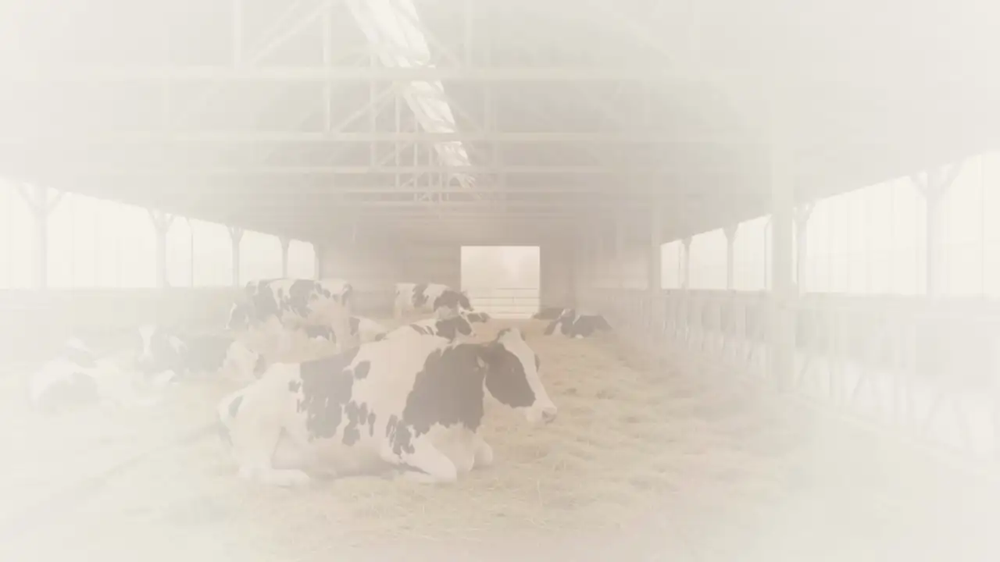

<div align="center">


# Orbit

### Ask for it. Orion builds it.

The open-source farm app for cattle and horses.<br>
It runs on your own computer, and its built-in AI assistant, Orion, shapes it into what your farm needs.

[](https://github.com/kristianvast/orbit/releases/latest)
[](LICENSE)


[**Download**](#download) · [Website](https://barnstar.dev) · [Architecture](docs/ARCHITECTURE.md) · [Roadmap](docs/ROADMAP.md) · [Contributing](CONTRIBUTING.md)

<a href="https://barnstar.dev/assets/video/v11-orbit-motion/v11-orbit-motion-light_audio.mp4"></a>

<sub>▶ <a href="https://barnstar.dev/assets/video/v11-orbit-motion/v11-orbit-motion-light_audio.mp4">Watch the full film with sound</a> (55 seconds)</sub>

</div>

## Why Orbit

- **It starts small.** A fresh install shows Home, Ask Orion and Settings. You add only the screens you use.
- **You say what you need.** Type or talk to Orion. It builds the pages, connections and automations for your farm.
- **Your data lives on your PC.** Records work offline. Sync to the cloud is optional.
- **Every change can be undone.** Each edit Orion makes is saved as a snapshot you can revert with one click.

> **Status:** early release. Interfaces, database tables and cloud endpoints may still change.

## Download

| System                              | Installer                                                                                                                     |
| ----------------------------------- | ----------------------------------------------------------------------------------------------------------------------------- |
| **Windows** (x64)                   | [Orbit-Windows.exe](https://github.com/kristianvast/orbit/releases/latest/download/Orbit-Windows.exe)                         |
| **macOS** (Apple Silicon)           | [Orbit-macOS-Apple-Silicon.dmg](https://github.com/kristianvast/orbit/releases/latest/download/Orbit-macOS-Apple-Silicon.dmg) |
| **macOS** (Intel)                   | [Orbit-macOS-Intel.dmg](https://github.com/kristianvast/orbit/releases/latest/download/Orbit-macOS-Intel.dmg)                 |
| **Linux** (x64)                     | [Orbit-Linux-x64.AppImage](https://github.com/kristianvast/orbit/releases/latest/download/Orbit-Linux-x64.AppImage)           |
| **Linux** (ARM64, Debian or Ubuntu) | [Orbit-Linux-arm64.deb](https://github.com/kristianvast/orbit/releases/latest/download/Orbit-Linux-arm64.deb)                 |

More formats (`.msi`, `.deb`) are on the [latest release](https://github.com/kristianvast/orbit/releases/latest). Orbit updates itself in the background.

**Getting started takes three steps:**

1. **Switch Orion on.** Create a free Orbit account (30 days of Orion, no card needed) or bring your own AI key or subscription.
2. **Tell Orion about your farm.** Dairy cattle, beef cattle or horses, and what you want to see first.
3. **Ask for what you need.** A calving watch, a dry-cow board, a connection to your milking system.

## What Orion can do

|                                 |                                                                                                                                      |
| ------------------------------- | ------------------------------------------------------------------------------------------------------------------------------------ |
| 🐄 **Herd records**             | Add and find cattle and horses, and record inseminations, pregnancy checks, calvings, foalings and treatments.                       |
| 🧩 **Custom pages**             | Ask for a screen that fits your routine. Orion builds it, with a live card on Home.                                                  |
| 🔌 **Connections**              | Import CSV files, install verified add-ons from the [`skills/`](skills) catalog, or have Orion build a connector for your equipment. |
| 📷 **Barn cameras**             | Find ONVIF cameras on the barn network and watch them live on a barn map.                                                            |
| 🎙️ **Voice**                    | Talk to Orion hands-free and hear it answer.                                                                                         |
| 🖥️ **Other programs**           | Orion can operate herd or robot software on your PC that has no export, and use the web for you.                                     |
| 🧠 **Memory**                   | Orion remembers your barn layout, groups and routines between conversations.                                                         |
| ↩️ **Ask first, undo anything** | Orion asks before risky steps, and every change it makes can be reverted from Settings.                                              |

Orbit knows real barn rules too: an animal wears a collar **or** a bolus **or** an ear tag sensor, never several at once.

## Your data stays yours

- Farm data lives in a local SQLite database on your computer and works without internet.
- Passwords and keys go to your operating system's keychain, never into the database or chat.
- Sign in only if you want cloud sync and to invite owners, managers, workers and viewers.
- Records map to the [ICAR ADE](https://github.com/adewg/ICAR) livestock data standard, so they are not locked into Orbit.
- Feedback and shared builds are sent only after you say yes, and Orion refuses to upload anything that looks like a secret.

## Free and open source

Orbit is free. Run it fully locally with your own AI key from providers such as Anthropic, OpenAI or Google, or create a free Orbit account for a 30-day trial of Orion with no card. Optional paid plans cover cloud AI, voice minutes and sync: see [pricing](https://barnstar.dev/pricing/).

## For developers

| Name      | What it is                                                         | Where it lives                     |
| --------- | ------------------------------------------------------------------ | ---------------------------------- |
| **Orbit** | The desktop app (Tauri 2, React, TypeScript, Vite)                 | [`apps/orbit`](apps/orbit)         |
| **Orion** | The AI agent and local data server (Bun sidecar, SQLite writer)    | [`packages/orion`](packages/orion) |
| **Core**  | The optional cloud (Hono API, Postgres, sync, AI gateway, billing) | [`core/api`](core/api)             |

You need [Bun](https://bun.sh) 1.3+ and Node.js 22.19+. No Rust, Tauri or Docker is needed for browser development.

```bash
scripts/locked-install.sh              # install dependencies
bun run --filter '@orion/agent' dev    # terminal 1: Orion with a demo farm
bun run --filter '@orbit/app' dev      # terminal 2: the Orbit UI
```

```bash
bun run lint && bun run typecheck && bun run test
```

**Read more:** [Architecture](docs/ARCHITECTURE.md) · [Design system](apps/orbit/DESIGN.md) · [Core cloud setup](core/README.md) · [Testing](docs/TESTING.md) · [Roadmap](docs/ROADMAP.md) · [Contributing](CONTRIBUTING.md) · [CLA](CLA.md) · [Security](SECURITY.md)

## License

Orbit is dual-licensed: open source under [AGPL-3.0-only](LICENSE), with a paid [commercial license](COMMERCIAL.md) from AgroIntel for closed-source use. See [LICENSING.md](LICENSING.md) or write to [kristian@agrointel.no](mailto:kristian@agrointel.no).
